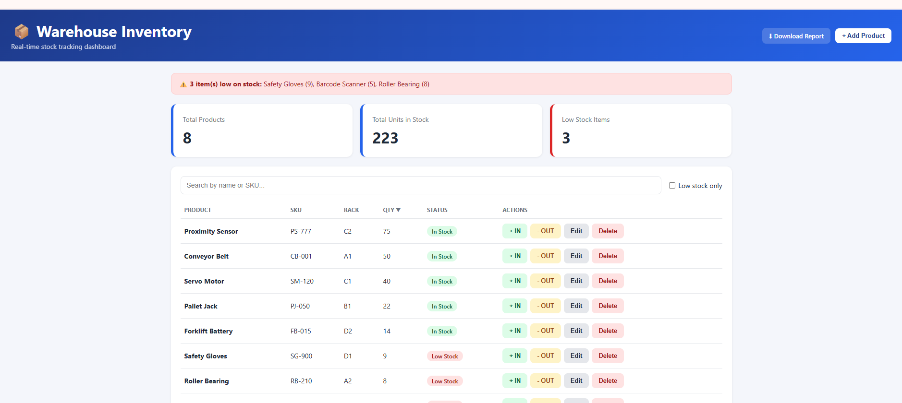

# Warehouse Inventory Dashboard

A full-stack inventory management app for warehouse stock tracking, built with Node.js, Express, MySQL and vanilla JavaScript.

## Features
- Product CRUD with search and low-stock filter
- Stock IN / OUT with validation (cannot remove more than available)
- Stock update and movement history saved in a single database transaction
- Low stock alert banner
- Sortable product table
- CSV stock report download
- Dashboard with summary cards, stock-level chart and movement history

## Tech Stack
Node.js, Express.js, MySQL, JavaScript, HTML/CSS, Chart.js, Git

## Setup
1. Install Node.js and XAMPP (start MySQL)
2. Run the SQL in `database.sql` (phpMyAdmin -> SQL tab)
3. `npm install`
4. Copy `.env.example` to `.env`
5. `npm start` and open http://localhost:3000

## API Endpoints
| Method | Endpoint | Description |
|---|---|---|
| GET | /api/products?search=&low=true | List products |
| GET | /api/products/export | Download CSV report |
| POST | /api/products | Add product |
| PUT | /api/products/:id | Update product |
| DELETE | /api/products/:id | Delete product |
| POST | /api/stock/in | Add stock |
| POST | /api/stock/out | Remove stock |
| GET | /api/stock/history | Recent movements |
| GET | /api/stock/history/:productId | History of one product |
| GET | /api/stats | Dashboard numbers |

## Screenshots

### Dashboard

### Stock Chart and Movement History

